# MotorMates

<p align="center">Red social para entusiastas de los autos: reseña carros, encuentra Car Meets en el mapa y modifica tu carro con IA antes de gastar un peso.</p>

MotorMates es una aplicación Android como proyecto para la clase de Computacion Movil de la Pontificia Universidad Javeriana, construida con Jetpack Compose, pensada como una red social para entusiastas de los autos: permite iniciar sesión/registrarse, ver un feed de reseñas de vehículos publicadas por otros usuarios y buscar/explorar autos por categoría.

Realizada por: 

Juan Jose Ballesteros Suarez

Juan Diego Rojas Osorio 

Diego Alejandro Melgarejo Bejarano

Jose Alejandro Villarroel Marcano

## 🎬 Demo

<p align="center">
  <a href="https://youtu.be/U5mdVr6K2O0">
    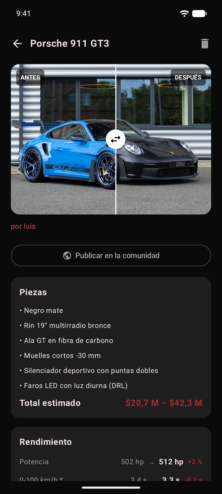
  </a>
</p>

<p align="center">
  <a href="https://youtu.be/U5mdVr6K2O0"><b>▶ Ver el demo completo</b></a><br>
  <sub>Recorrido por el feed, Explorar, AI Tuning y el mapa de Car Meets</sub>
</p>

## Características

- **Autenticación**: pantallas de inicio de sesión y registro (`LoginScreen`, `RegisterScreen`).
- **Feed**: timeline de "stories" y reseñas de autos (`FeedScreen`) con acciones de like/comentario.
- **Búsqueda**: exploración de autos por categorías con resultados en grilla (`SearchScreen`).
- **Onboarding y feed personalizado**: al entrar se pregunta qué carros, marcas y ciudad le gustan al usuario (y su carro, con autocompletado de la API vPIC de la NHTSA). Con eso se ordena Explorar ("Para ti"), Siguiendo nunca queda vacía (personas sugeridas y reseñas destacadas) y el mapa arranca en su ciudad. Ver [docs/onboarding.md](docs/onboarding.md).
- **Mapa de reseñas recientes**: pestaña "Mapa" del feed con un marcador por cada reseña
  publicada en las últimas 24 horas (`ReviewsMapScreen`). Al tocar un marcador se muestra el
  autor, el vehículo, la calificación y el comentario. Requiere configurar una API key de
  Google Maps (ver abajo).
- **AI Tuning (Modificaciones con AI)**: desde el detalle de un vehículo se eligen piezas
  reales de un catálogo (o una foto propia de una pieza, o una idea libre) y Gemini genera la
  foto del carro modificado, con comparador antes/después, costo estimado en COP, cambios de
  rendimiento calculados por la app, ficha técnica y precios en vivo con Google. Los resultados
  se guardan como *Builds* en el perfil y se pueden publicar. Requiere el plan Blaze y
  Firebase AI Logic: ver [docs/ai-tuning.md](docs/ai-tuning.md).
- **Navegación** simple entre Login → Registro → Feed → Búsqueda, manejada en `MainActivity`.

## Tecnologías

- **Kotlin** 2.2.10
- **Jetpack Compose** (BOM 2026.02.01) con Material 3
- **Android Gradle Plugin** 9.3.1
- `minSdk` 26 · `targetSdk` / `compileSdk` 37

## Estructura del proyecto

```
app/src/main/java/com/example/motormates/
├── MainActivity.kt              # Punto de entrada y navegación entre pantallas
└── ui/
    ├── screens/
    │   ├── LoginScreen.kt
    │   ├── RegisterScreen.kt
    │   ├── FeedScreen.kt
    │   └── SearchScreen.kt
    └── theme/                    # Color, tipografía y tema de Compose
```

## 📱 Capturas

Capturas reales de la app corriendo en un dispositivo Android.

### Comunidad

<table align="center">
  <tr>
    <td align="center">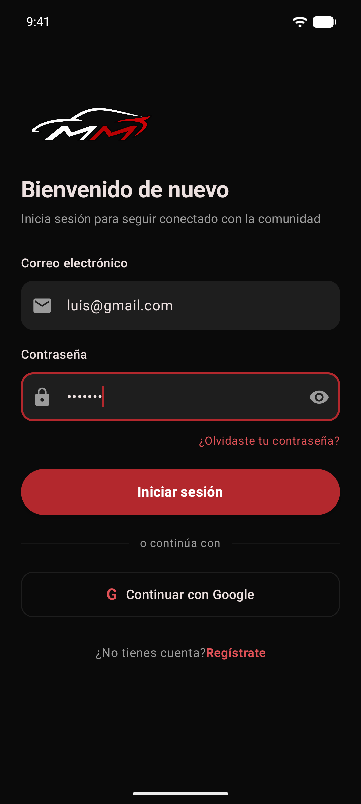</td>
    <td align="center">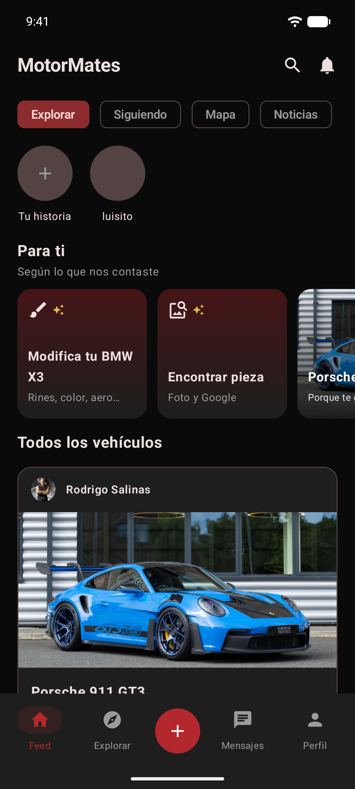</td>
    <td align="center">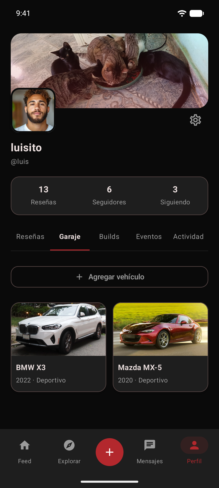</td>
  </tr>
  <tr>
    <td align="center"><sub><b>Acceso</b><br>Correo o Google</sub></td>
    <td align="center"><sub><b>Feed</b><br>Historias, Para ti y reseñas</sub></td>
    <td align="center"><sub><b>Perfil</b><br>Reseñas, garaje y builds</sub></td>
  </tr>
</table>

### Descubre carros

<table align="center">
  <tr>
    <td align="center">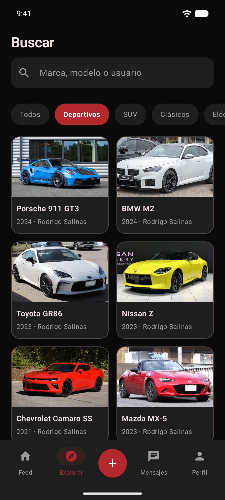</td>
    <td align="center">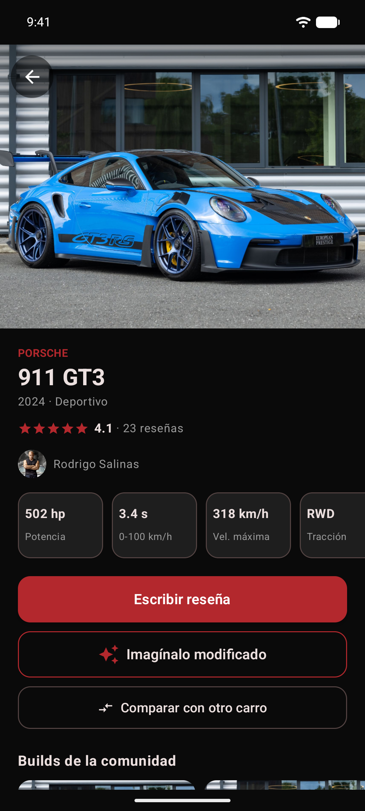</td>
    <td align="center">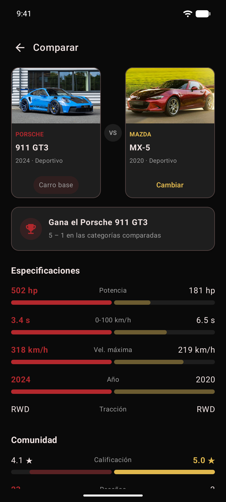</td>
  </tr>
  <tr>
    <td align="center"><sub><b>Explorar</b><br>Búsqueda por marca y categoría</sub></td>
    <td align="center"><sub><b>Ficha del vehículo</b><br>Especificaciones y reseñas</sub></td>
    <td align="center"><sub><b>Comparador</b><br>Tu carro frente a otro</sub></td>
  </tr>
</table>

### AI Tuning ✨

<table align="center">
  <tr>
    <td align="center">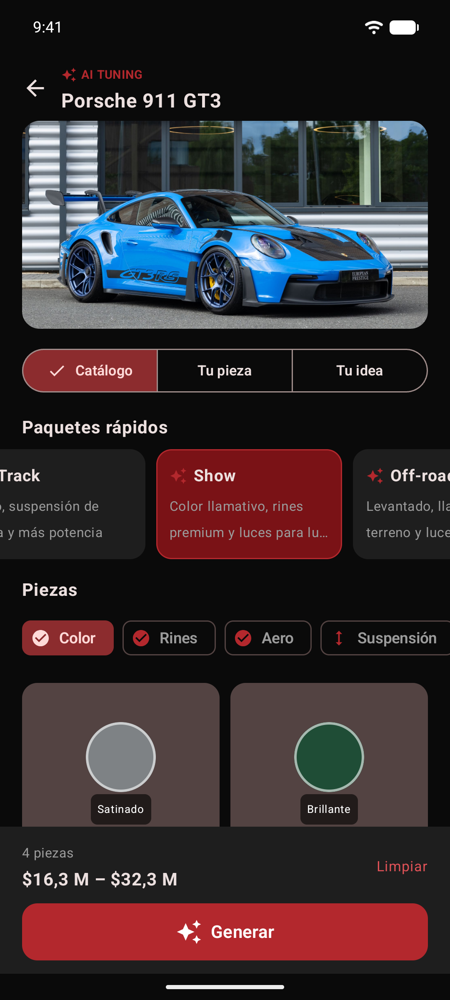</td>
    <td align="center"></td>
    <td align="center">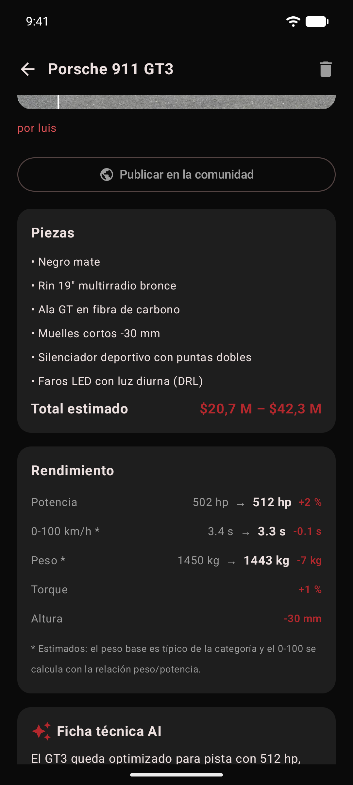</td>
  </tr>
  <tr>
    <td align="center"><sub><b>Elige las piezas</b><br>Catálogo, foto propia o idea libre</sub></td>
    <td align="center"><sub><b>Antes / después</b><br>Imagen generada con Gemini</sub></td>
    <td align="center"><sub><b>Tu Build</b><br>Costo en COP y rendimiento</sub></td>
  </tr>
</table>

### En la calle

<table align="center">
  <tr>
    <td align="center">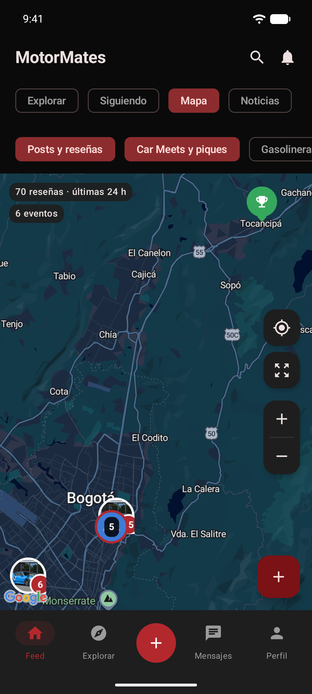</td>
    <td align="center">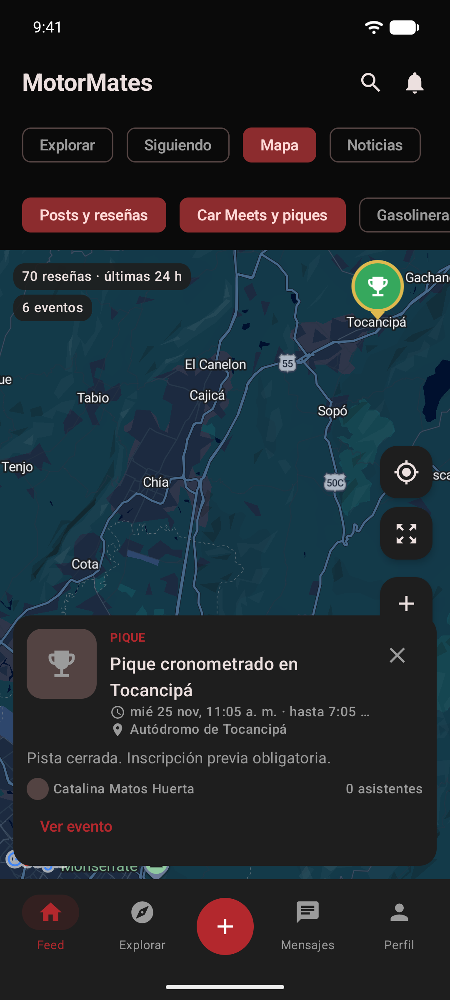</td>
    <td align="center">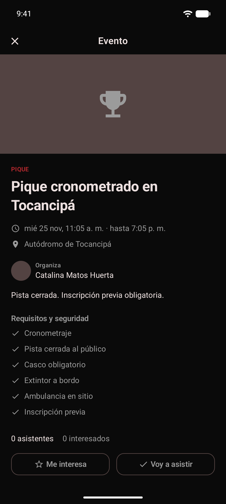</td>
  </tr>
  <tr>
    <td align="center"><sub><b>Mapa</b><br>Reseñas de las últimas 24 h</sub></td>
    <td align="center"><sub><b>Car Meets y piques</b><br>Toca un marcador para ver el detalle</sub></td>
    <td align="center"><sub><b>Eventos</b><br>Organiza y únete a encuentros</sub></td>
  </tr>
</table>

<details>
<summary><b>Ver los mockups originales de Figma</b></summary>

<p align="center">
  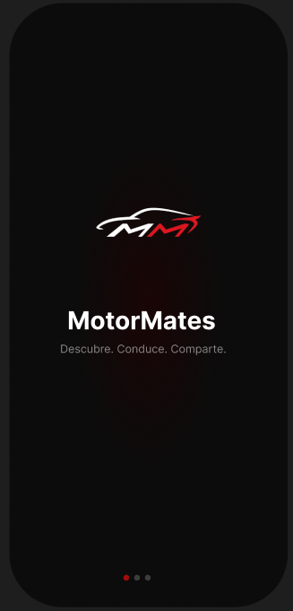
  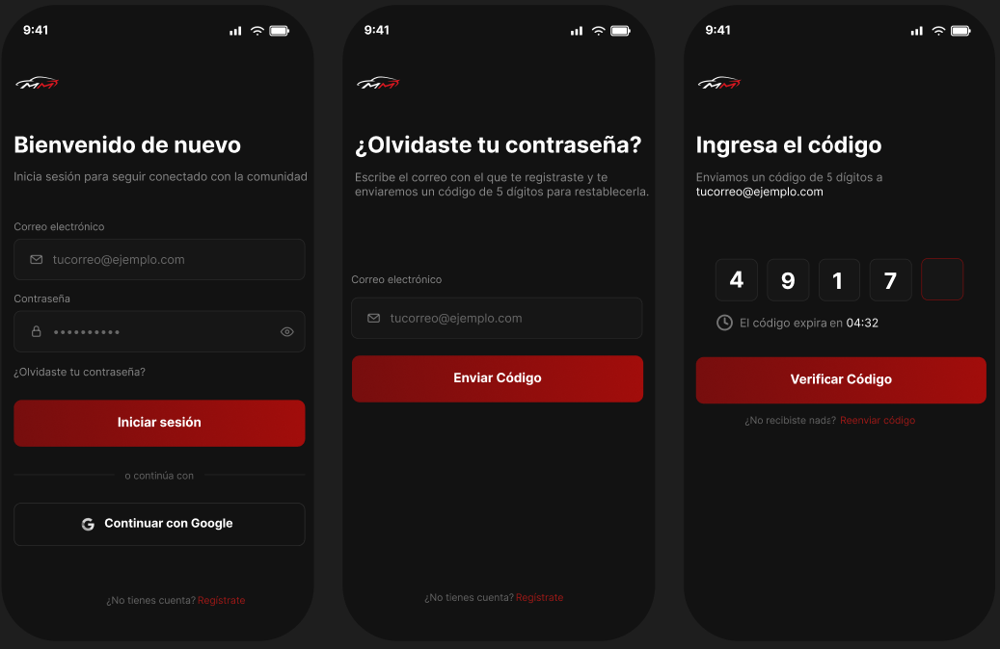
  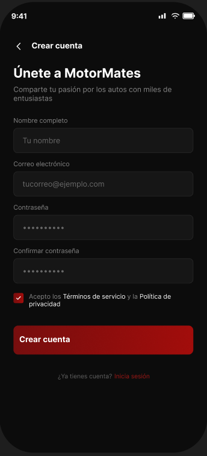
  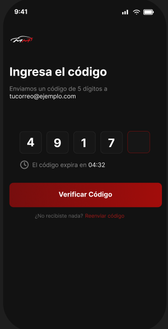
</p>

<p align="center">
  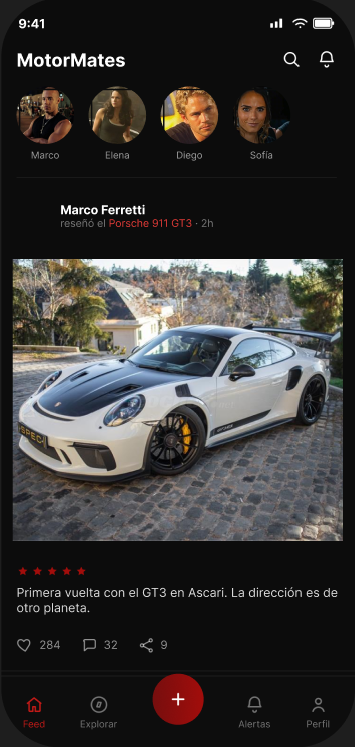
  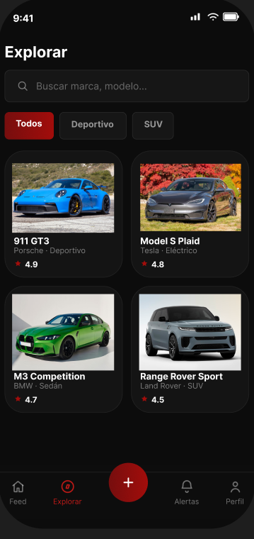
  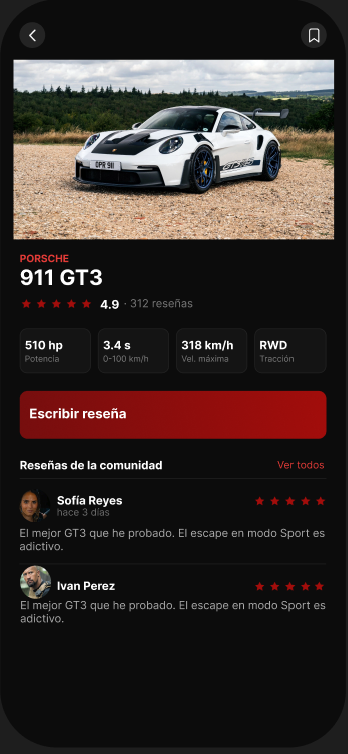
  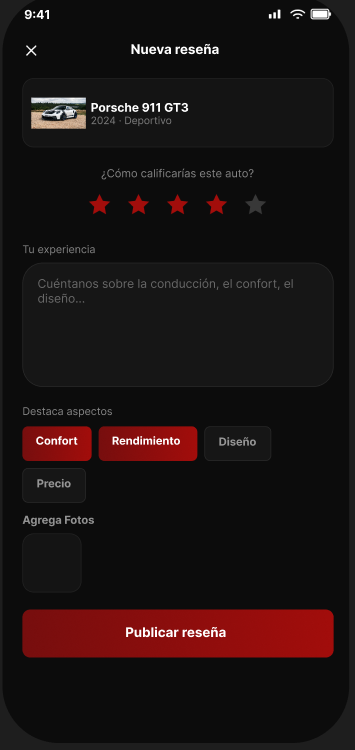
</p>

<p align="center">
  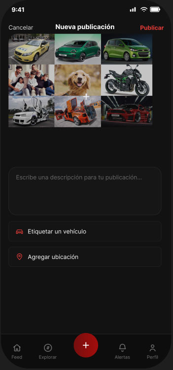
  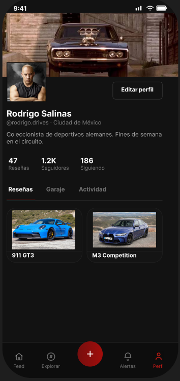
  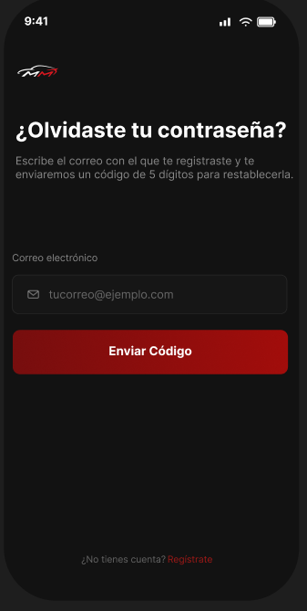
</p>

El mockup completo de la aplicación puede encontrarse en: https://www.figma.com/design/XQnzsdVDgozx4DGIly9Frd/MotorMates?node-id=0-1&t=FVrxFJMQnO9jtzlo-1

</details>

## Requisitos

- Android Studio (versión compatible con AGP 9.3.1)
- JDK 11+
- Android SDK con la API 37 instalada

## Cómo ejecutar

1. Clona el repositorio.
2. Abre el proyecto en Android Studio.
3. Pon tu `app/google-services.json` (ver la sección siguiente). **Sin este archivo el
   proyecto no compila.**
4. Configura tu API key de Google Maps.
5. Sincroniza Gradle (o desde consola: `./gradlew build`).
6. Ejecuta la app en un emulador o dispositivo físico con Android 8.0 (API 26) o superior.

### Configuración de Firebase

`app/google-services.json` **no está en el repositorio**: lleva los identificadores del
proyecto de cada uno, así que está en `.gitignore`. El proyecto aplica el plugin
`google-services`, que **aborta la compilación** si el archivo falta — por eso este paso
no es opcional, a diferencia de las API keys de más abajo.

1. Crea un proyecto en la [consola de Firebase](https://console.firebase.google.com/) y
   registra una app Android con el package `com.example.motormates`.
2. Descarga el `google-services.json` que te entrega la consola y déjalo en `app/`.
3. Habilita **Authentication** (Correo/contraseña y Google), **Cloud Firestore**,
   **Storage**, **Remote Config** y **App Check**.
4. Despliega las reglas de Firestore, que ya vienen en el repo:

```bash
firebase deploy --only firestore:rules
```

> **No hace falta ninguna API key de Gemini.** AI Tuning habla con Gemini a través de
> **Firebase AI Logic** (`com.google.firebase:firebase-ai`), que se autentica con la
> identidad de la app — el `google-services.json` más App Check — y no con una llave.
> Por eso no hay un `GEMINI_API_KEY` en `local.properties`: una key de Gemini dentro del
> APK sería extraíble por cualquiera, y es justo lo que AI Logic existe para evitar.

Para que **AI Tuning** genere imágenes hacen falta además el plan **Blaze** (los modelos
de imagen lo exigen) y activar **AI Logic** en la consola. Los nombres de los modelos y el
backend (`vertex_ai` o `google_ai`) se controlan desde **Remote Config**, sin publicar otra
versión de la app; la app trae valores por defecto si no configuras nada. El procedimiento
completo — alerta de presupuesto, tokens de depuración de App Check y la tabla de
parámetros — está en [docs/ai-tuning.md](docs/ai-tuning.md).

Si te saltas el setup de AI Tuning, la app **compila y corre igual**: solo falla al tocar
"Modificar con AI", con un mensaje de error en pantalla en vez de la imagen generada.

### API key de Google Maps

La pestaña "Mapa" del feed usa el **Maps SDK for Android**, que necesita una API key propia.
La del `google-services.json` **no** sirve: no viene habilitada para Maps.

1. En [Google Cloud Console](https://console.cloud.google.com/), habilita **Maps SDK for
   Android** y crea una API key.
2. Agrégala a `local.properties`, que está en `.gitignore` y por eso no se comparte:

```properties
MAPS_API_KEY=TU_LLAVE_AQUI
```

`app/build.gradle.kts` la lee y la inyecta en el manifest. Si la key falta, el proyecto
**compila igual**, pero el mapa se ve como una cuadrícula gris y en logcat aparece un
`Authorization failure`.

> Para probar el mapa, recuerda que solo muestra reseñas de las **últimas 24 horas**. Si la
> base de datos se sembró hace más de un día, borra la colección `reviews` (o usa el emulador
> de Firebase) para que el seeder vuelva a correr con fechas frescas. Al publicar una reseña
> desde el emulador, fija primero una ubicación en *Extended controls → Location*.

### API key de Places (capas de estaciones)

Los filtros **Gasolineras** y **Carga eléctrica** del mapa consultan la **Places API (New)**,
que es un producto aparte del Maps SDK: habilitar uno no habilita el otro. Las dos capas usan
la misma llave, así que se habilitan juntas.

1. En [Google Cloud Console](https://console.cloud.google.com/), habilita **Places API (New)**.
   Puedes hacerlo sobre la misma key que ya usas para el mapa.
2. Si vas a usar una key distinta, agrégala a `local.properties`:

```properties
PLACES_API_KEY=TU_LLAVE_AQUI
```

Si no defines `PLACES_API_KEY`, se usa `MAPS_API_KEY`. Y si ninguna de las dos está, el
proyecto **compila igual**: los chips "Gasolineras" y "Carga eléctrica" simplemente no
aparecen en el mapa, en vez de aparecer y fallar al tocarlos.

> Ojo con el costo: cada consulta se cobra, y **cada capa consulta por separado**, así que
> con las dos chips prendidas el gasto se duplica. Cada capa trae cuatro frenos para que un
> rato mirando el mapa no se convierta en cientos de llamadas — espera a que sueltes el mapa
> (600 ms), no consulta por debajo de zoom 13, ignora los movimientos de menos del 30 % de
> lo que abarca la pantalla, y reutiliza la misma zona durante 5 minutos. Los valores están
> en el `companion object` de `ReviewsMapViewModel` (el piso de zoom, en `ReviewsMapState`).

```bash
# Compilar el proyecto
./gradlew build

# Instalar en un dispositivo/emulador conectado
./gradlew installDebug
```

## Tests

```bash
# Tests unitarios
./gradlew test

# Tests instrumentados (requiere dispositivo/emulador)
./gradlew connectedAndroidTest
```
