# MotorMates

MotorMates es una aplicación Android como proyecto para la clase de Computacion Movil de la Pontificia Universidad Javeriana, construida con Jetpack Compose, pensada como una red social para entusiastas de los autos: permite iniciar sesión/registrarse, ver un feed de reseñas de vehículos publicadas por otros usuarios y buscar/explorar autos por categoría.

Realizada por: 

Juan Jose Ballesteros Suarez

Juan Diego Rojas Osorio 

Diego Alejandro Melgarejo Bejarano

Jose Alejandro Villarroel Marcano

## Características

- **Autenticación**: pantallas de inicio de sesión y registro (`LoginScreen`, `RegisterScreen`).
- **Feed**: timeline de "stories" y reseñas de autos (`FeedScreen`) con acciones de like/comentario.
- **Búsqueda**: exploración de autos por categorías con resultados en grilla (`SearchScreen`).
- **Mapa de reseñas recientes**: pestaña "Mapa" del feed con un marcador por cada reseña
  publicada en las últimas 24 horas (`ReviewsMapScreen`). Al tocar un marcador se muestra el
  autor, el vehículo, la calificación y el comentario. Requiere configurar una API key de
  Google Maps (ver abajo).
- **Navegación** simple entre Login → Registro → Feed → Búsqueda, manejada en `MainActivity`.

## Tecnologías

- **Kotlin** 2.2.10
- **Jetpack Compose** (BOM 2026.02.01) con Material 3
- **Android Gradle Plugin** 9.3.1
- `minSdk` 26 · `targetSdk` / `compileSdk` 37

## Estructura del proyecto

```
app/src/main/java/com/example/motormates/
├── MainActivity.kt              # Punto de entrada y navegación entre pantallas
└── ui/
    ├── screens/
    │   ├── LoginScreen.kt
    │   ├── RegisterScreen.kt
    │   ├── FeedScreen.kt
    │   └── SearchScreen.kt
    └── theme/                    # Color, tipografía y tema de Compose
```

## Mockups

A continuación se presentan los mockups de las principales pantallas de MotorMates.

<p align="center">
  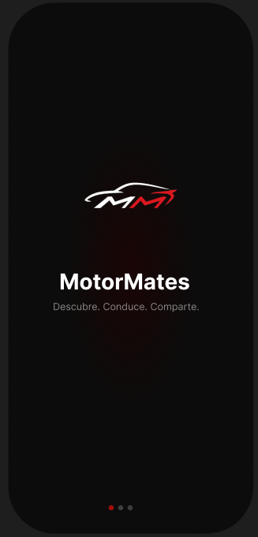
  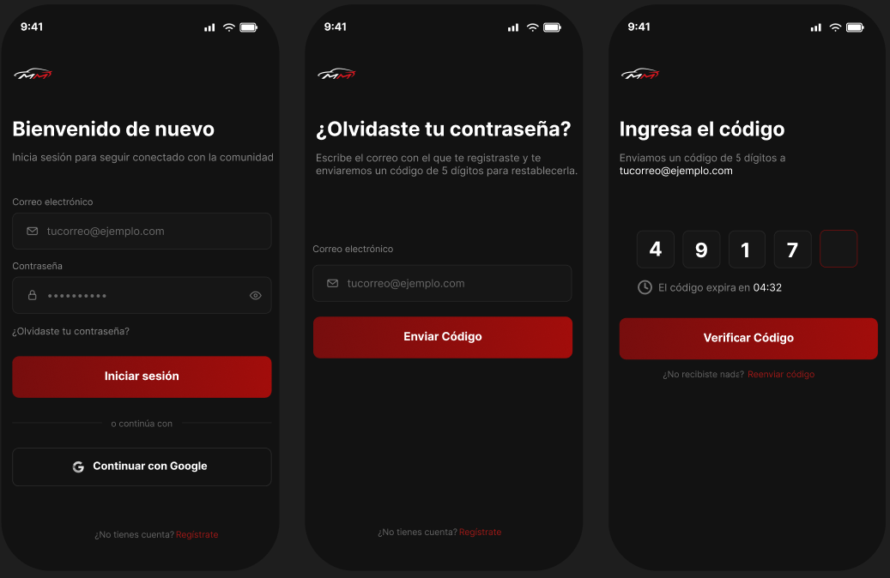
  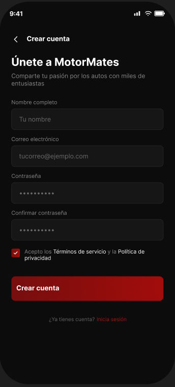
  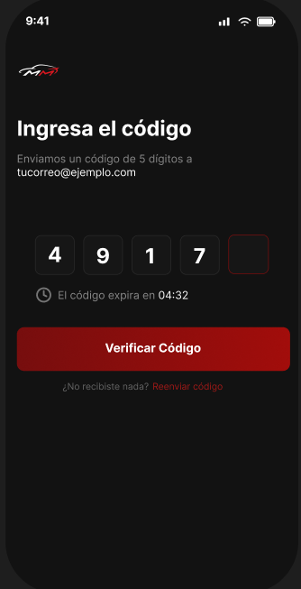
</p>

<p align="center">
  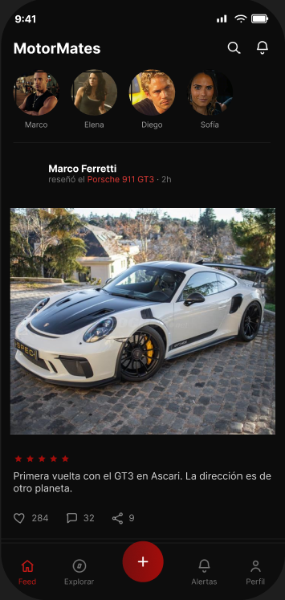
  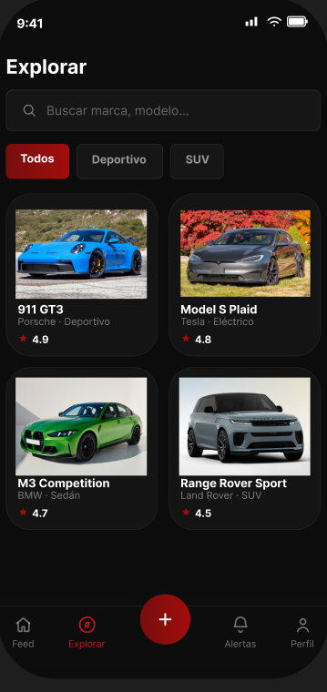
  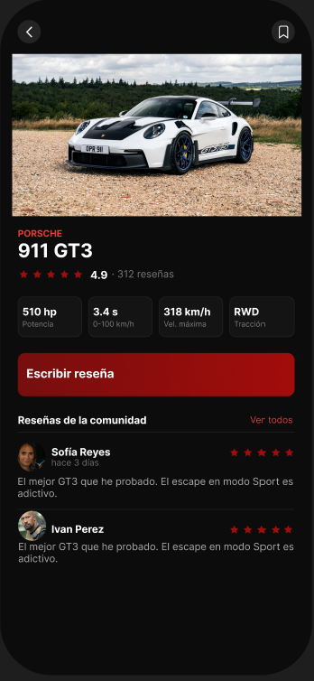
  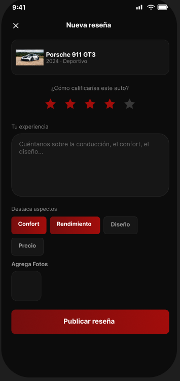
</p>

<p align="center">
  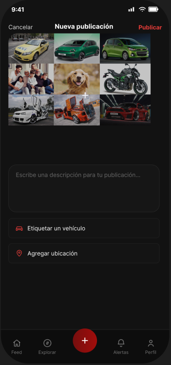
  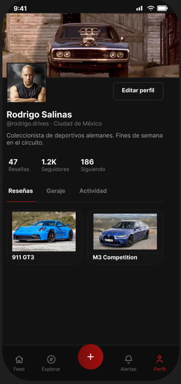
  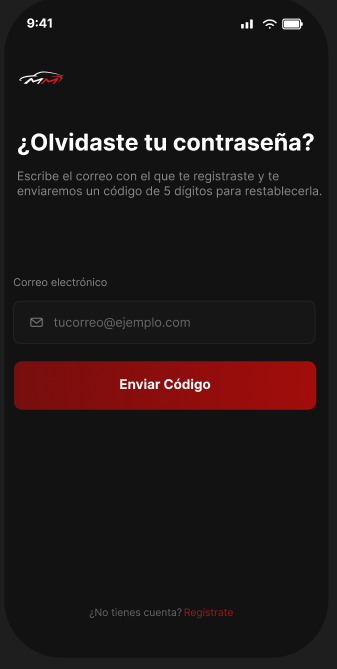
</p>

El mockup completo de la aplicación puede encontrarse en: https://www.figma.com/design/XQnzsdVDgozx4DGIly9Frd/MotorMates?node-id=0-1&t=FVrxFJMQnO9jtzlo-1

## Requisitos

- Android Studio (versión compatible con AGP 9.3.1)
- JDK 11+
- Android SDK con la API 37 instalada

## Cómo ejecutar

1. Clona el repositorio.
2. Abre el proyecto en Android Studio.
3. Configura tu API key de Google Maps (ver la sección siguiente).
4. Sincroniza Gradle (o desde consola: `./gradlew build`).
5. Ejecuta la app en un emulador o dispositivo físico con Android 8.0 (API 26) o superior.

### API key de Google Maps

La pestaña "Mapa" del feed usa el **Maps SDK for Android**, que necesita una API key propia.
La del `google-services.json` **no** sirve: no viene habilitada para Maps.

1. En [Google Cloud Console](https://console.cloud.google.com/), habilita **Maps SDK for
   Android** y crea una API key.
2. Agrégala a `local.properties`, que está en `.gitignore` y por eso no se comparte:

```properties
MAPS_API_KEY=TU_LLAVE_AQUI
```

`app/build.gradle.kts` la lee y la inyecta en el manifest. Si la key falta, el proyecto
**compila igual**, pero el mapa se ve como una cuadrícula gris y en logcat aparece un
`Authorization failure`.

> Para probar el mapa, recuerda que solo muestra reseñas de las **últimas 24 horas**. Si la
> base de datos se sembró hace más de un día, borra la colección `reviews` (o usa el emulador
> de Firebase) para que el seeder vuelva a correr con fechas frescas. Al publicar una reseña
> desde el emulador, fija primero una ubicación en *Extended controls → Location*.

```bash
# Compilar el proyecto
./gradlew build

# Instalar en un dispositivo/emulador conectado
./gradlew installDebug
```

## Tests

```bash
# Tests unitarios
./gradlew test

# Tests instrumentados (requiere dispositivo/emulador)
./gradlew connectedAndroidTest
```
